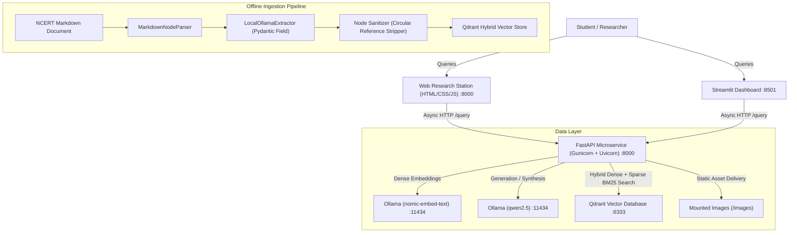

# NCERT Multimodal Knowledge Explorer & Visual RAG

An industrial-grade Multimodal Retrieval-Augmented Generation (RAG) microservice and interactive study station designed to query NCERT textbook content (text and diagrams).

Built with **FastAPI**, **Qdrant**, **LlamaIndex**, **Ollama**, **Streamlit**, and a **custom modern HTML/CSS/JS Research Station**.

---

## Architecture Overview



---

## Key Features

- **Multimodal Retrieval**: Retrieves both text excerpts and corresponding textbook maps, historical photos, and political cartoons linked directly in the chapter metadata.
- **Unique Non-Chatbot Interface**: Dedicated academic workstation with quick concept chips, structured synthesis reports, source citation cards with match scores, and a diagram inspector with lightbox modal.
- **Dual UI Support**:
  - Pure Modern Web UI served directly by FastAPI at `http://localhost:8000/`.
  - Streamlit Visual Dashboard served at `http://localhost:8501/`.
- **Industrial Microservice Design**:
  - Fully asynchronous FastAPI endpoints (`/query`, `/health`).
  - Production-ready `pydantic-settings` configuration with `.env` management.
  - Standardized Python logging with structured formats.
  - Global exception handlers returning standard HTTP status codes.
- **Robust Edge Case Solutions**:
  - **LlamaIndex Circular Reference Bug Fix**: Strips recursive node relationships down to primitive types `(str, int, float, bool)` before pushing to Qdrant to eliminate Pydantic serialization crashes.
  - **Pydantic Extractor Declaration**: `LocalOllamaExtractor` declares `llm` as a Pydantic `Field` to satisfy schema validation.
  - **Timeout Safeguards**: Qdrant client set to `60.0s` and Ollama synthesis set to `300.0s` to prevent local timeout drops.
  - **Ragas v1.0 Evaluation**: Native support for instantiated metrics (`Faithfulness`, `AnswerRelevancy`, `ContextPrecision`) with flattened string ground-truth references.
- **Dual Compatibility**: Works out of the box locally and in **Hugging Face Spaces** (Docker and local persistence fallback).

---

## Project Structure

```text
NCERT/
├── .env.example                # Template configuration file
├── .env                        # Local environment variables
├── requirements.txt            # Production Python dependencies
├── docker-compose.yml          # Multi-container orchestration (Qdrant + API + UI)
├── Dockerfile                  # Unified container for Hugging Face Spaces
├── Dockerfile.api              # Production API container (Gunicorn + Uvicorn)
├── Dockerfile.ui               # Streamlit UI container
├── app/
│   ├── main.py                 # FastAPI application, static mounts & exception handlers
│   ├── api/
│   │   ├── dependencies.py     # Dependency injection providers
│   │   └── v1/
│   │       ├── router.py       # API v1 central router
│   │       └── endpoints/
│   │           ├── health.py   # System & database health probe
│   │           └── query.py    # Async query & multimodal synthesis endpoint
│   ├── core/
│   │   ├── config.py           # Application settings with pydantic-settings
│   │   └── logging.py          # Structured Python logger
│   ├── models/
│   │   └── schemas.py          # Pydantic data contracts (Request, Response, Metadata)
│   └── services/
│       ├── qdrant_service.py   # Qdrant client connection manager & health checks
│       └── rag_service.py      # LlamaIndex query engine & diagram URL resolver
├── frontend/                   # Modern Interactive Web Interface (HTML/CSS/JS)
│   ├── index.html              # Research Station template
│   ├── css/
│   │   └── style.css           # Responsive dark theme styling
│   └── js/
│       └── app.js              # Vanilla JS frontend client & lightbox
├── ui/
│   └── app.py                  # Streamlit visual dashboard
├── scripts/
│   ├── clean_textbook.py       # Text preprocessor for raw NCERT markdown
│   ├── ingest.py               # Robust offline data ingestion pipeline
│   └── evaluate.py             # Ragas v1.0 automated evaluation script
├── data/
│   ├── ncert_chapter.md        # Cleaned textbook chapter
│   └── raw_ncert.md            # Raw textbook chapter
└── images/                     # Textbook maps, figures, and political cartoons
    ├── images (1).png
    ├── ...
    └── images (7).png
```

---

## Local Setup & Quickstart

### Prerequisites

1. **Python 3.11+**
2. **Ollama**: Download from [ollama.com](https://ollama.com) and pull models:
   ```bash
   ollama pull qwen2.5
   ollama pull nomic-embed-text
   ```
3. **Docker Desktop** (optional, recommended for Qdrant and containerized execution)

---

### Option A: Local Direct Run

1. **Clone the repository and install dependencies**:
   ```bash
   pip install -r requirements.txt
   ```

2. **Start Qdrant Vector Database**:
   ```bash
   docker run -d -p 6333:6333 -p 6334:6334 -v qdrant_storage:/qdrant/storage qdrant/qdrant:latest
   ```

3. **Ingest Textbook Content**:
   ```bash
   python scripts/ingest.py
   ```

4. **Launch the FastAPI Backend & Web Explorer**:
   ```bash
   uvicorn app.main:app --host 0.0.0.0 --port 8000 --reload
   ```
   Open your browser at:
   - **Interactive Web Research Station**: [http://localhost:8000/](http://localhost:8000/)
   - **Interactive API Documentation**: [http://localhost:8000/docs](http://localhost:8000/docs)

5. **Launch the Streamlit UI** (in a separate terminal):
   ```bash
   streamlit run ui/app.py
   ```
   Access at: [http://localhost:8501/](http://localhost:8501/)

---

### Option B: Docker Compose (Full Stack)

Run all three services (Qdrant, FastAPI, Streamlit) simultaneously:

```bash
docker compose up --build
```

- **Web Research Station & API**: [http://localhost:8000/](http://localhost:8000/)
- **Streamlit Dashboard**: [http://localhost:8501/](http://localhost:8501/)
- **Qdrant Dashboard**: [http://localhost:6333/dashboard](http://localhost:6333/dashboard)

---

## Running Ragas v1.0 Evaluation

Benchmark the accuracy, faithfulness, and context retrieval precision:

```bash
python scripts/evaluate.py
```

The script evaluates test cases against the ground truth using `Faithfulness`, `AnswerRelevancy`, and `ContextPrecision` metrics.

---
